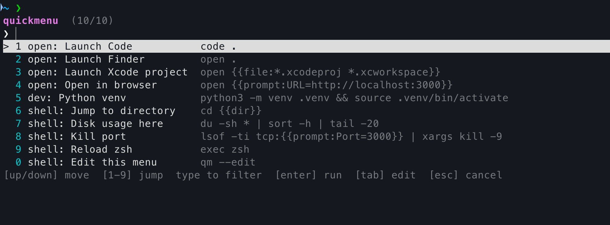

# quickmenu

[](https://github.com/prashant1207/zsh-quickmenu/actions/workflows/tests.yml)
[](LICENSE)
[](https://www.zsh.org/)

A launcher menu for zsh — press **Ctrl-G**, pick the thing you want, done. No more
trying to remember whether it was `op`, `o`, or `ff` that opened Finder.



Type to filter, or press the number next to an item.

- **No dependencies.** Pure zsh. `fzf` is supported but not required.
- **Config, not code.** One line per item in a plain text file — or JSON if
  something generates it for you.
  ```ini
  [open]
  Launch Code   = code .
  Launch Finder = open .
  ```
- **Context aware.** Git items only appear inside a repo, `npm` items only when
  there's a `package.json`.
- **Arguments without the guesswork.** Items can prompt for a value or pop a
  second menu to choose a file, branch or script.
- **Per-project menus.** Drop a `.quickmenu.conf` into a repo and its commands
  show up only there.
- Chosen commands land in your shell history, exactly as if you'd typed them.

## Install

Requires zsh 5.3 or newer. Nothing else.

<details open>
<summary><b>oh-my-zsh</b></summary>

```sh
git clone https://github.com/prashant1207/zsh-quickmenu \
  "${ZSH_CUSTOM:-$HOME/.oh-my-zsh/custom}/plugins/quickmenu"
```

Then add it to your plugin list in `~/.zshrc`:

```sh
plugins=( ... quickmenu )
```
</details>

<details>
<summary><b>Manual / plain zsh</b></summary>

```sh
git clone https://github.com/prashant1207/zsh-quickmenu ~/.zsh/zsh-quickmenu
echo 'source ~/.zsh/zsh-quickmenu/quickmenu.plugin.zsh' >> ~/.zshrc
```

`./install.sh` does the same thing, and links into `$ZSH_CUSTOM/plugins/` if it
finds an oh-my-zsh install.
</details>

<details>
<summary><b>zinit</b></summary>

```sh
zinit light prashant1207/zsh-quickmenu
```
</details>

<details>
<summary><b>antidote</b></summary>

```sh
# .zsh_plugins.txt
prashant1207/zsh-quickmenu
```
</details>

<details>
<summary><b>zplug</b></summary>

```sh
zplug "prashant1207/zsh-quickmenu"
```
</details>

<details>
<summary><b>antigen</b></summary>

```sh
antigen bundle prashant1207/zsh-quickmenu
```
</details>

Then `exec zsh` and press **Ctrl-G**. The first run writes a commented starter
menu to `~/.config/quickmenu/menu.conf`.

## Usage

| | |
|---|---|
| `Ctrl-G` | open the menu |
| `qm` | same thing, as a command |
| `qm xcode` | pre-filter; runs immediately if only one item matches |
| `qm --list` | print every item |
| `qm --add 'Label' 'command' [group]` | append an item to your config |
| `qm --edit` | open your menu config in `$EDITOR` |
| `qm --config` | show which config files are being loaded |
| `qm --print` | resolve the chosen command and print it instead of running it |
| `qm --index 3` | pick item 3 without opening the menu |

Inside the menu:

| | |
|---|---|
| `↑` `↓` / `Ctrl-P` `Ctrl-N` | move (wraps around) |
| `1`–`9`, `0` | jump straight to a visible row |
| any letters | fuzzy filter |
| `Backspace` / `Ctrl-U` | trim / clear the filter |
| `Enter` | run it |
| `Tab` | put it on the prompt so you can edit first |
| `Esc` / `Ctrl-C` | cancel |


## Configuring the menu

Your menu is **plain config, not code**. On first run quickmenu writes a commented
`~/.config/quickmenu/menu.conf` for you; open it with `qm --edit`.

```ini
[open]
Launch Code          = code .
Launch Finder        = open .
Launch Xcode project = open {{file:*.xcodeproj *.xcworkspace}}
.desc                = ios swift mobile

[git]
.if = git rev-parse --is-inside-work-tree        # whole section is git-only

Commit everything   = git add -A && git commit -m {{prompt:Message=Automated commit}}
Push current branch = git push -u origin HEAD
Discard all changes = git reset --hard && git clean -fd
.confirm            = yes
```

That's the whole format:

- `Label = command` is an item. Everything after the first `=` is the command, so
  `Has equals = FOO=bar ./run.sh` works fine.
- `[section]` starts a group; the section name is shown before each label.
- Lines starting with a dot are **settings**. Put one *after* an item to attach it
  to that item, or *before* any item to apply it to the whole section.
- Whole-line `#` or `;` comments, and `\` at end of line to continue.

| setting | meaning |
|---|---|
| `.if` | only show the item while this shell command exits 0 |
| `.desc` | extra words to match on when filtering |
| `.group` | override the section name |
| `.confirm` | `yes` → ask `y/N` before running |
| `.edit` | `yes` → put it on the prompt instead of running it |

A section `.if` and an item `.if` are ANDed together.

Don't like `=`? You never have to type it — `qm --add 'Deploy prod' './deploy.sh prod' ops`
appends the item for you.

### Commands that need an argument

Placeholders are filled in after you pick the item:

| placeholder | what happens |
|---|---|
| `{{prompt:Label}}` | asks you to type a value |
| `{{prompt:Label=default}}` | …with a default you can accept with Enter |
| `{{pick:some command}}` | runs the command, you pick one of its output lines |
| `{{file:*.xcodeproj *.xcworkspace}}` | you pick a matching file/dir in `$PWD` |
| `{{dir}}` | you pick a sub-directory |
| `{{env:NAME}}` | expands an environment variable |

If a `pick`/`file` placeholder matches exactly one thing, it's used without asking.

```ini
Launch Xcode project = open {{file:*.xcodeproj *.xcworkspace}}
Switch branch        = git switch {{pick:git branch --format="%(refname:short)"}}
Commit everything    = git add -A && git commit -m {{prompt:Message=Automated commit}}
Kill port            = lsof -ti tcp:{{prompt:Port=3000}} | xargs kill -9
```

Values are **shell-quoted** before substitution, so a commit message like
`it's a fix; rm -rf /` is harmless. If you genuinely want raw text — extra flags,
for instance — add a `!`:

```ini
Commit (custom flags) = git commit {{prompt!:Flags=-a --amend}}
```

## Other config formats

Every file below is loaded if it exists, in this order. Mix and match freely.

| file | format |
|---|---|
| `~/.config/quickmenu/menu.conf` | the text format above |
| `~/.config/quickmenu/menu.json` | JSON |
| `~/.config/quickmenu/menu.zsh` | zsh script, for anything dynamic |
| `~/.config/quickmenu/menu.d/*.{conf,json,zsh}` | extra snippets |
| `./.quickmenu.{conf,json,zsh}` | project-local, searched upwards from `$PWD` |

`qm --config` prints exactly which files are in play.

### JSON

Good when something else generates your menu. Read with `jq`, falling back to
`python3` — set `QUICKMENU_JSON=jq` or `QUICKMENU_JSON=python3` to pin one.
Either a bare array or `{"items": [...]}` works.

```json
{
  "items": [
    { "label": "Launch Code", "run": "code .", "group": "open" },
    {
      "label": "Commit everything",
      "run": "git add -A && git commit -m {{prompt:Message=Automated commit}}",
      "group": "git",
      "if": "git rev-parse --is-inside-work-tree"
    },
    { "label": "Discard all changes", "run": "git reset --hard", "confirm": true }
  ]
}
```

Keys: `label` (or `name`), `run` (or `command`/`cmd`), `group`, `desc`, `if`,
`confirm`, `edit`. See [`examples/menu.json`](examples/menu.json).

### zsh

For items that need real logic. This is the only format that executes code at load
time, and everything in the `.conf`/JSON formats maps onto it.

```sh
qm_item [-g group] [-d desc] [-c condition] [-e] [-y] <label> <command>
qm_git_item ...        # shorthand for -c 'git rev-parse --is-inside-work-tree'
```

```sh
qm_item -g open 'Launch Code' 'code .'
qm_item -g dev  'npm install' 'npm install' -c '[[ -f package.json ]]'

# build the menu on the fly
for host in $(cut -d' ' -f1 ~/.ssh/known_hosts 2>/dev/null | head -5); do
  qm_item -g ssh "Connect to $host" "ssh $host"
done
```

Options may come before or after the label and command. See
[`examples/menu.zsh`](examples/menu.zsh).

### Per-project menus

Drop a `.quickmenu.conf` into a repo and its commands only show up there:

```ini
# ~/work/api/.quickmenu.conf
[api]
Start dev server = docker compose up -d && npm run dev
Tail logs        = docker compose logs -f api
Run migrations   = npm run migrate -- {{prompt:Target=latest}}
```

Files that aren't owned by you, or that are group/world writable, are skipped. Set
`QUICKMENU_LOCAL=0` to turn project menus off, or `QUICKMENU_UNSAFE_CONFIG=1` to skip
the ownership checks.

## Settings

| variable | default | |
|---|---|---|
| `QUICKMENU_KEY` | `^G` | keybinding; set to `''` to skip binding |
| `QUICKMENU_HEIGHT` | `12` | visible rows |
| `QUICKMENU_TITLE` | `quickmenu` | header text |
| `QUICKMENU_PROMPT` | `❯ ` | filter prompt |
| `QUICKMENU_CONFIG_DIR` | `~/.config/quickmenu` | where configs live |
| `QUICKMENU_CONFIG` | unset | use exactly this file, skipping discovery |
| `QUICKMENU_LOCAL` | `1` | load project-local menus |
| `QUICKMENU_LOCAL_FILE` | unset | look for only this project filename |
| `QUICKMENU_PICKER` | `auto` | `tui`, `fzf` or `dumb` |
| `QUICKMENU_USE_FZF` | unset | set to use fzf when installed |
| `QUICKMENU_JSON` | `auto` | JSON backend: `auto`, `jq` or `python3` |
| `QUICKMENU_NO_COLOR` | unset | plain output |
| `QUICKMENU_QUIET` | unset | don't echo the command before running |
| `QUICKMENU_UNSAFE_CONFIG` | unset | skip config ownership checks |

Set them before the plugin loads:

```sh
QUICKMENU_KEY='^K'
QUICKMENU_HEIGHT=20
plugins=( ... quickmenu )
```

## Tests

```sh
python3 tests/run_tests.py
```
98 checks covering all three config formats, discovery, conditions, placeholder
resolution and quoting, and the interactive menu itself — driven with real
keystrokes over a pty, including the Ctrl-G widget in an interactive shell.
CI runs them on Linux and macOS, with and without `jq`.

## Troubleshooting

**Ctrl-G does nothing.** Something else may have claimed the key — check with
`bindkey '^G'`. Pick another one before the plugin loads: `QUICKMENU_KEY='^K'`.

**My items don't show up.** Run `qm --config` to see which files are actually
being read. Items with an `.if` condition are hidden when it fails, and config
files that aren't owned by you (or are group/world writable) are skipped with a
warning.

**The menu shows garbage characters.** Your locale isn't UTF-8; quickmenu falls
back to ASCII glyphs automatically, and `QUICKMENU_NO_COLOR=1` helps on terminals
that don't handle ANSI well.

**It's slow to open.** Every `.if` condition runs each time the menu opens. Keep
them cheap — `[[ -f package.json ]]` rather than anything that hits the network.

## Contributing

Bug reports and patches are welcome — see [CONTRIBUTING.md](CONTRIBUTING.md) for
the project layout, the test suite and the house style, or
[AGENTS.md](AGENTS.md) if you're working with an AI coding agent. The
[Code of Conduct](CODE_OF_CONDUCT.md) applies to every space in the project.

## License

[MIT](LICENSE) © Prashant Tiwari
